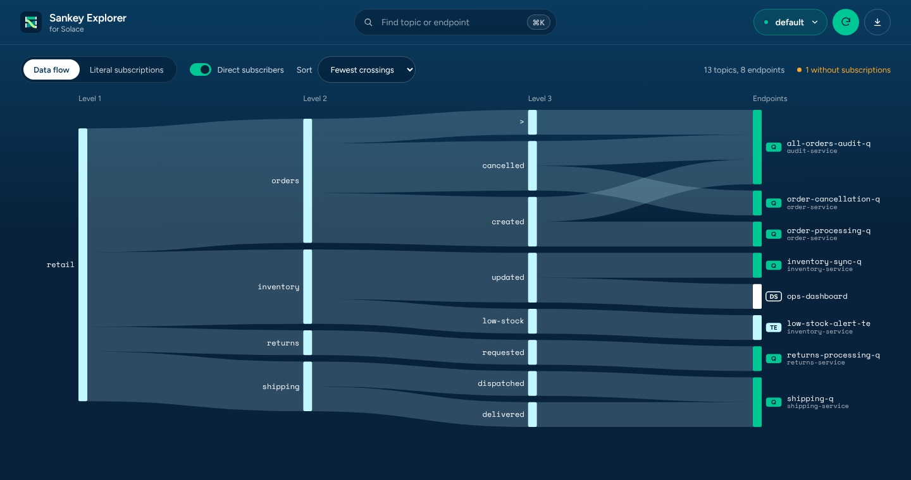

# Sankey Explorer for Solace

See which topics flow into which queues, topic-endpoints, and direct
subscribers on a Solace broker - live, as a Sankey diagram.



## Quick start

```bash
docker pull ghcr.io/solacelabs/sankey-explorer-for-solace
docker run -p 4000:4000 ghcr.io/solacelabs/sankey-explorer-for-solace:latest
```

Open **http://localhost:4000**, then connect it to your broker on the
"Connect to Message VPN" screen: the SEMP management host (e.g.
`http://broker-host:8080`), the VPN name, and a read-only user. No config,
no env vars, no login required by default.

Broker credentials are entered in the browser and live only in memory for
that session - never written to disk, never sent anywhere but your broker.

## Features

- **Live, zero setup** - reads straight from the broker's SEMP v2 API,
  nothing to provision or configure beforehand
- **Wildcard-aware** - a `topic/>` subscription is shown covering every
  more specific topic it actually receives, not just its own literal
  string (the "View" toggle switches to literal mode)
- **Multiple brokers/VPNs at once**, combined into one diagram, color-coded
- **Hover any node or link** to highlight its whole flow - in "Data flow"
  view a wildcard endpoint's flow includes every topic its wildcard covers
- **Click it** (or find it with the search, ⌘K / Ctrl K) to open a detail
  panel: which endpoints a topic reaches, and whether through their own
  subscription or a wider wildcard. "Show only this" then filters the
  diagram down to that chain
- **Endpoint types at a glance** - Q (queue), TE (topic endpoint) and DS
  (direct subscriber) badges next to every endpoint
- **Export** the diagram as SVG, or a broker connection as YAML (saved as
  plaintext locally - handle it like a password file)
- Counts queues/topic-endpoints with zero subscriptions in the toolbar
  (hover for their names) instead of quietly dropping them
- **Live metrics overlay** (opt-in, ▶ in the diagram toolbar) - polls SEMP v2
  every 5, 15 or 30 s and marks each endpoint as active, idle or backlog,
  with in/out message rates and spool usage next to it, green links into
  endpoints that are receiving right now, and full details plus an on-demand
  consumer list in the detail panel. See [Live metrics](#live-metrics)

## How it works

```
Browser (React)  →  Express backend  →  Solace broker (SEMP v2, read-only)
```

One instance per customer/workshop, not a shared multi-tenant service. App
login is optional (`APP_USERNAME` + `APP_PASSWORD_HASH` env vars) - leave
both unset to run with no login at all. See `.env.example` for every
available env var (all optional).

**Security note:** with no login, anyone who can reach the app can make *it* call
broker URLs. Link-local/cloud-metadata addresses are always refused; set
`ALLOWED_BROKER_HOSTS` to restrict connections to your brokers, and `TRUST_PROXY=0`
when running without a reverse proxy.

## Live metrics

Press ▶ in the diagram toolbar to start polling; ⏸ pauses, ⟳ takes one sample
right away. Polling is off by default, at most one request is in flight, and
any configuration load (Refresh, managing or disconnecting Message VPNs)
pauses it and clears the samples, so old numbers never sit on a new diagram.
A failed poll keeps the last good sample and shows the error in the toolbar.

What the overlay reads (SEMP v2 Monitor API, all `vpn/read-only`):

| Endpoint | Attributes |
|---|---|
| Queue | `rxMsgRate`, `txMsgRate`, `averageRxMsgRate`, `averageTxMsgRate`, `msgSpoolUsage`, `maxMsgSpoolUsage`, `txUnackedMsgCount`, `ingressEnabled`, `egressEnabled` |
| Topic endpoint | same, with `maxSpoolUsage` as the quota |
| Direct subscriber (client) | `txMsgRate` / `averageTxMsgRate` (delivered to the client), `rxMsgRate` / `averageRxMsgRate` (published by it), `clientUsername` |
| Consumers (on demand) | `.../queues/{name}/txFlows`, `.../topicEndpoints/{name}/txFlows` |

One poll costs three `select`-limited list requests per Message VPN (more
only past 100 objects per collection), within the app's usual SEMP throttle.

Status rules: **active** - messages arriving or leaving; **backlog** - a
queue/topic endpoint holds messages and its spool grew since the previous
sample, is at 80% or more of its quota, or nothing is going out; **idle** -
known, nothing moving. Endpoints without a value in the sample stay unmarked.

Limits worth knowing, all from SEMP v2 itself:

- There is no current message count or bind count on a queue or topic
  endpoint (`spooledMsgCount` counts every message ever spooled), so the
  backlog is shown in bytes and consumers are listed on request.
- Rates exist per endpoint, not per topic, so only the last link into an
  endpoint is colored - upstream topic links stay neutral.
- Quotas come in MB and are read as 2^20 bytes for the fill level.

## Local development

One npm package, one process - the server also runs the client dev server
(with hot reload) as middleware, so there's only one command and one port:

```bash
npm install
npm run dev   # http://localhost:4000
```

No broker handy? `scripts/seed-demo-broker.sh` seeds a small demo setup
(queues, subscriptions, a wildcard) on a local broker.

## Build it yourself

```bash
docker build -t sankey-explorer .
docker run -p 4000:4000 sankey-explorer
```
